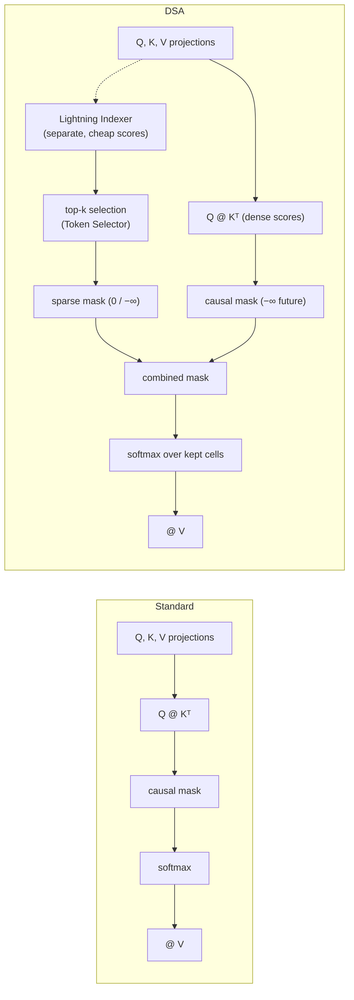
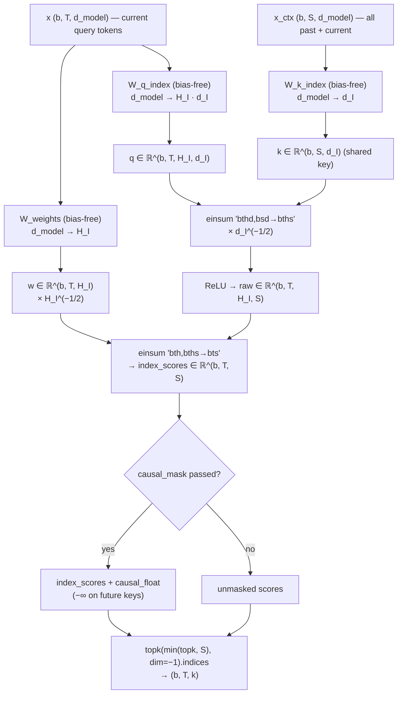
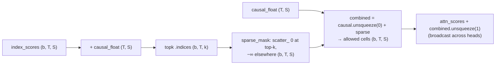
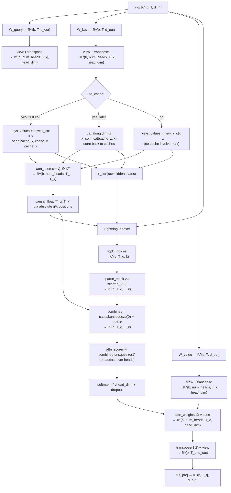

# DeepSeek Sparse Attention (DSA) — First-Principles Design Notes

## What is DSA?

DeepSeek Sparse Attention (DSA, [DeepSeek-V3.2](https://huggingface.co/deepseek-ai/DeepSeek-V3.2)) replaces the *fixed rules* of other sparse-attention schemes — a sliding window of width `W` (SWA) or a grouped-query split (GQA) — with a **learned, per-query selection** of which past tokens to attend to.

| | Standard causal MHA | DSA (`topk = k`) |
|---|---|---|
| Who decides the active context | nobody — every past token is scored | a lightweight *Lightning Indexer* scores all past tokens per query |
| Number of attended tokens per query | `q` tokens (position `q` and earlier) | at most `k` (the top-`k` by learned score) |
| Prefill compute | `O(L² · d)` | `O(L² · (d + H_I·d_I))` dense-mask here; `O(L·k·d + L²·H_I·d_I)` with a fused kernel |
| KV cache | `n_heads · head_dim` per token per layer | same as MHA **plus** `d_model` raw inputs (`cache_x`) |
| Selection pattern | fixed lower triangle | **content-dependent, non-contiguous** spans |

A query at absolute position `q` may lawfully attend to *any* earlier position. DSA just refuses to attend to more than `k` of them, and the choice of which `k` is learned.

> **Teaching vs. production.** This file applies DSA's top-`k` *selection logic* as a dense mask on top of standard attention. It reproduces exactly which tokens are attended, but it materializes the full `L×L` score matrix, so it does **not** deliver the fused-kernel compute/memory savings (`O(L²) → O(L·k)`). Section [Compute and memory analysis](#compute-and-memory-analysis) quantifies this.

---

## Architecture at a glance

DSA is *two new components wrapped around ordinary multi-head attention*:



The golden rule that separates the two pieces:

- **The Lightning Indexer decides *which* tokens** (a cheap scorer; `H_I = 4` tiny heads).
- **The attention heads decide *how much* weight** each selected token gets (the standard softmax, restricted to the selection).

The selection is decided **before** softmax, on a *separate projection space* — it never reuses the attention Q/K.

---

## Structural invariants (`__init__` contract)

```python
assert d_out % num_heads == 0, "d_out must be divisible by num_heads"
```

| Invariant | Effect |
|---|---|
| `d_out % num_heads == 0` | `head_dim = d_out // num_heads` is an integer; every attention head gets an equal slice of the projected output. |
| `index_n_heads × index_head_dim` (no extra rule) | The indexer query projection is `d_model → H_I·d_I` — an **arbitrary** small dimension, unrelated to `num_heads` or `head_dim`. |
| `index_head_dim` (shared key) | `W_k_index` emits a **single** key vector of width `d_I` per token, shared across all index heads (only queries are per-head). |

Two deliberate *non*-constraints worth noting:

- `index_n_heads` need **not** divide `num_heads`. The indexer is a separate scorer, not a partition of the attention heads.
- `index_head_dim` need **not** equal `head_dim`. In the default config they happen to coincide (`64 = 64`); that is a coincidence, not a contract.

Reference config used throughout this document (same shape math as a 124M-class model):

| Symbol | Value | Meaning |
|---|---|---|
| `d_in` / `d_model` | 768 | embedding / input width |
| `d_out` | 768 | projected width = `num_heads · head_dim` |
| `num_heads` | 12 | standard attention heads |
| `head_dim` | 64 | per-head dim (`√head_dim = 8` softmax scale) |
| `index_n_heads` (`H_I`) | 4 | Lightning Indexer heads |
| `index_head_dim` (`d_I`) | 64 | indexer head dim (`√d_I = 8` index scale) |
| `topk` (`k`) | 3 | (small, for legible worked examples; the shipped default is 64) |

---

## Component 1 — The Lightning Indexer

### Intended score

For each query token `t` and each candidate past token `s`:

$$I_{t,s} = \sum_{j=1}^{H_I} \frac{w_{t,j}}{\sqrt{H_I}} \cdot \text{ReLU}\!\left(\frac{q_{t,j} \cdot k_s}{\sqrt{d_I}}\right)$$

where `q_{t,j}` is indexer head `j`'s query for token `t`, `k_s` is the *shared* indexer key for token `s`, and `w_{t,j}` is a learned per-head gate for token `t`.

### Code → math mapping

| Code (intended) | Tensor | Role |
|---|---|---|
| `self.W_q_index(x).view(b, T, H_I, d_I)` | `q ∈ ℝ^(b, T, H_I, d_I)` | per-head indexer **queries** |
| `self.W_k_index(x_ctx)` | `k ∈ ℝ^(b, S, d_I)` | one **shared key** per context token |
| `self.W_weights(x)` | `w ∈ ℝ^(b, T, H_I)` | per-head gate scalars |
| `self.scale = d_I ** -0.5` | — | `1/√d_I`, folded into `raw` |
| `w * (H_I ** -0.5)` | — | `1/√H_I`, folded into the gates |

### Forward steps (any mode)

```python
raw = torch.einsum("bthd,bsd->bths", q, k) * self.scale   # (b, T, H_I, S) dot products, scaled
raw = torch.relu(raw)                                     # ReLU: negative matches contribute 0
w   = self.W_weights(x) * (self.index_n_heads ** -0.5)    # (b, T, H_I) gated sum coefficients
index_scores = torch.einsum("bth,bths->bts", w, raw)      # (b, T, S) one score per (query, key)
```

Two first-principles notes:

- **Keys are shared across index heads.** `W_k_index` is `d_model → d_I` (not `→ H_I·d_I`). Each past token maps to a single lightweight key; the heads only differ in how they *query* it. This is what makes the indexer ~6× cheaper per pair than the full attention path (`H_I·d_I = 256` vs. `2·d_out = 1536` multiply-adds).
- **Gates are raw learned scalars, not a softmax** over heads (contrast with attention). The reference implementation scales them by `1/√H_I` exactly as written above; a softmax would change the training dynamics and is *not* what DeepSeek's code does.

### Indexer flowchart



---

## Component 2 — The Token Selector (mask composition, from first principles)

### The mask pipeline



Every attention cell `(q, s)` survives to softmax **iff both** constraints agree:

```
allowed(q, s)  =  causal(q, s)   AND   selected(q, s)
```

- `causal` says the key is not in the future (`q_pos ⟂ k_pos` → `−∞` where `q < k`).
- `selected` says the key is among the query's top-`k` indexer scores.

### Worked example (topk = 2, T = 4)

Illustrative indexer scores (values invented for clarity):

```
q\k     0       1       2       3
 0     0.8     0.3     0.1     0.2
 1     0.2     0.9     0.4     0.6
 2     0.5     0.7     0.6     0.1
 3     0.3     0.1     0.9     0.4
```

Step 1 — the causal mask is added *before* selection:

```
q\k     0       1       2       3
 0     0      −∞      −∞      −∞
 1     0       0      −∞      −∞
 2     0       0       0      −∞
 3     0       0       0       0
```

Step 2 — mask then select (top-2 of each row):

```
row 0:  [0.8, −∞, −∞, −∞]  →  top-2 = {0, tie on an −∞ slot}
row 1:  [0.2, 0.9, −∞, −∞]  →  {0, 1}
row 2:  [0.5, 0.7, 0.6, −∞]  →  {1, 2}
row 3:  [0.3, 0.1, 0.9, 0.4] →  {2, 3}
```

Step 3 — scatter `0` into those columns, `−∞` everywhere else (`sparse_mask`):

```
q\k     0       1       2       3
 0     0       0      −∞      −∞     ← note: includes a tied −∞ slot picked by topk
 1     0       0      −∞      −∞
 2    −∞       0       0      −∞
 3    −∞      −∞       0       0
```

Step 4 — add the causal mask back (combined = the *intersection*):

```
q\k     0       1       2       3      attended tokens per row
 0     0      −∞      −∞      −∞      →  1
 1     0       0      −∞      −∞      →  2
 2    −∞       0       0      −∞      →  2
 3    −∞      −∞       0       0      →  2
```

### Why the causal mask must be applied *inside* the indexer

`topk` may be larger than the number of valid (non-future) positions — row 0 above. Because `sparse_mask` is built positionally from the returned indices, a query can "spend" part of its budget on a future column. The causal term in `combined_mask` is the **safety net** that deletes those cells again, guaranteeing:

- **row 0 always attends to exactly 1 token (itself), never 0 or k;**
- every row attends to **at most** `topk` tokens in the final softmax (this is the property `test_sparsity` asserts);
- with `topk ≥ seq_len`, `sparse_mask` is all zeros and the whole pipeline degenerates to plain causal MHA (this is the property `test_topk_full_equals_dense` asserts).

### DSA is *not* a window

The selection is content-dependent, so the attended pattern need not be contiguous — this is the fundamental difference from SWA:

```
Illustrative attended pattern (topk = 2, causal, T = 8)
■ = kept   ▓ = future (causal block)   ▒ = scored but not in top-k

q\k  0  1  2  3  4  5  6  7
0    ■  ▓  ▓  ▓  ▓  ▓  ▓  ▓
1    ■  ■  ▓  ▓  ▓  ▓  ▓  ▓
2    ▒  ■  ■  ▓  ▓  ▓  ▓  ▓
3    ▒  ■  ■  ▓  ▓  ▓  ▓  ▓
4    ▒  ▒  ■  ■  ▓  ▓  ▓  ▓
5    ▒  ■  ▒  ■  ▓  ▓  ▓  ▓   ← row 5 attends to columns 1 and 3: NOT a window!
6    ▒  ▒  ■  ■  ▓  ▓  ▓  ▓
7    ▒  ▒  ▒  ■  ■  ▓  ▓  ▓
```

Row 5 skips column 2 while keeping 1 and 3. A sliding window can never express that; DSA's learned scores can.

---

## Step-by-step forward pass (with KV cache)

Worked reference config: `b = 2`, chunk `T = 4` during prefill (and `T = 1` during decode), `d_in = d_out = 768`, `num_heads = 12`, `head_dim = 64`, `H_I = 4`, `d_I = 64`, `topk = 3`.

### Prefill (first cached call, input `x ∈ ℝ^(2, 4, 768)`)

**Step 1 — linear projections.**
```python
queries   = self.W_query(x)    # (2, 4, 768)  = 12 heads × 64
keys_new  = self.W_key(x)      # (2, 4, 768)
values_new= self.W_value(x)    # (2, 4, 768)
```

**Step 2 — reshape to heads.**
```python
queries = queries.view(2, 4, 12, 64)      # (b, T, n_heads, head_dim)
keys_new / values_new: same shape
```

**Step 3 — cache seed (`use_cache=True`, `cache_k is None`).**
```python
keys, values = keys_new, values_new       # (2, 4, 12, 64)
x_ctx        = x                          # (2, 4, 768)  ← raw inputs: indexer key source
self.cache_k, self.cache_v = keys, values
self.cache_x               = x_ctx
q_start, k_start = self.ptr_current_pos, 0   # 0, 0
self.ptr_current_pos += num_tokens           # 0 → 4
```

**Step 4 — transpose to per-head layout.**
```python
queries_t (2, 12, 4, 64)   keys_t (2, 12, 4, 64)   values_t (2, 12, 4, 64)
```

**Step 5 — dense attention scores.**
```python
attn_scores = queries_t @ keys_t.transpose(2, 3)   # (2, 12, 4, 4)  T_q = 4, T_k = 4
```

**Step 6 — causal mask on absolute positions.**
```python
q_positions = arange(0, 4)   k_positions = arange(0, 4)
causal_float (4, 4): 0 on the diagonal and below, −∞ above.   # (T_q, T_k)
```

**Step 7 — Lightning Indexer selection (the DSA step).**
```python
topk_indices = self.indexer(x, x_ctx, self.topk, causal_mask=causal_float)
# x (2, 4, 768) → q (2, 4, 4, 64)          x_ctx (2, 4, 768) → k (2, 4, 64)
# raw (2, 4, 4, 4)  →  gates (2, 4, 4)  →  index_scores (2, 4, 4)  [+ causal]
# k_val = min(3, 4) = 3  →  topk_indices (2, 4, 3)
```

**Step 8 — sparse mask + combine.**
```python
sparse_mask  (2, 4, 4): 0 at the top-3 slots, −∞ elsewhere
combined     = causal_float.unsqueeze(0) + sparse_mask     # (2, 4, 4)
attn_scores  = attn_scores + combined.unsqueeze(1)         # (2, 12, 4, 4)
```

**Step 9 — softmax, context, merge.**
```python
attn_weights = softmax(attn_scores / 64**0.5, dim=-1)     # (2, 12, 4, 4), scale = 8
context_vec  = attn_weights @ values_t                     # (2, 12, 4, 64)
context_vec.transpose(1,2).view(2, 4, 768)  →  out_proj    # (2, 4, 768)
```

### Decode (each subsequent token, input `x ∈ ℝ^(2, 1, 768)`)

**Step 3' — cache append (now `cache_k` is non-`None`).**
```python
keys   = cat([cache_k,   keys_new],   dim=1)   # (2, 5, 12, 64)
values = cat([cache_v,   values_new], dim=1)   # (2, 5, 12, 64)
x_ctx  = cat([cache_x,   x],          dim=1)   # (2, 5, 768)   ← cache_x grows alongside K/V
q_start = 4, k_start = 0, ptr_current_pos → 5
```

**Steps 5–9' — the same, with the crucial shape shift for a *single new query*:**
```python
attn_scores    (2, 12, 1, 5)
causal_float   (1, 5): q_pos=[4] → no cell has q < k, so all-zero (whole row allowed)
indexer:       q (2,1,4,64) · k (2,5,64) → raw (2,1,4,5) → index_scores (2,1,5)
               k_val = min(3, 5) = 3 → topk_indices (2, 1, 3)
sparse_mask    (2, 1, 5): exactly 3 kept slots
combined       (2, 1, 5) = (0-row) + sparse   → the query attends to its 3 best past tokens
attn_weights   (2, 12, 1, 5) @ values_t (2, 12, 5, 64) → (2, 12, 1, 64) → merge → (2, 1, 768)
```

The whole cached decode step is `O(S · d)` in the dense-mask teaching implementation (one query against all `S` cached keys) — the top-`k` mask changes *which* keys contribute, not the raw matmul cost. Only a fused kernel would make it `O(k · d)`.

---

## Full forward-pass flowchart



---

## KV cache design — the DSA-specific triple buffer

GQA and SWA cache **two** tensors per layer (`cache_k`, `cache_v`). DSA needs a **third**:

| Buffer | Shape (per layer) | Purpose |
|---|---|---|
| `cache_k` | `(b, T_cum, num_heads, head_dim)` | projected attention keys — reuse across decode steps |
| `cache_v` | `(b, T_cum, num_heads, head_dim)` | projected attention values |
| `cache_x` | `(b, T_cum, d_model)` | **raw input hidden states** for the indexer's `W_k_index` |

### Why `cache_x` exists (the DSA subtlety)

The indexer's keys come from `W_k_index(x_ctx)` — a projection of the **raw** input states, *not* the attention keys `W_key(x)`. The two projections are entirely different matrices with different target widths (`d_I = 64` vs `d_out = 768`); you cannot recover one from the other. So during cached decode the module must retain every past input vector, not just the K/V pair. Without `cache_x`, each step would have to replay the whole prefix through the embedding stack, which is exactly what a KV cache exists to avoid.

Cost of the third buffer: `d_model` elements per token per layer, on top of the `2·d_out` the K/V already cost — i.e. **1.5×** the plain MHA-with-cache footprint (2304 vs 1536 elements/token with `d_model = d_out = 768`).

### Growth semantics — unbounded, never trimmed

```python
if self.cache_k is None:
    keys, values, x_ctx = keys_new, values_new, x                  # seed
else:
    keys   = torch.cat([self.cache_k, keys_new], dim=1)            # append along token axis
    values = torch.cat([self.cache_v, values_new], dim=1)
    x_ctx  = torch.cat([self.cache_x, x],            dim=1)
self.cache_k, self.cache_v, self.cache_x = keys, values, x_ctx
```

DSA never trims the head of the cache the way SWA does. There is **no window**: every past token is a candidate for every query, so the full prefix must stay resident. `k_start` is therefore always `0`, and the causal mask keeps using absolute `q_positions` with a growing key span:

| Call | Input `x` | `ptr` before | `cache_k`/`cache_v` after | `cache_x` after | `q_start` | `k_start` | `ptr` after |
|---|---|---|---|---|---|---|---|
| prefill `[0..3]` | (2, 4, 768) | 0 | 4 tokens | 4 tokens | 0 | 0 | 4 |
| decode tok 4 | (2, 1, 768) | 4 | 5 tokens | 5 tokens | 4 | 0 | 5 |
| decode tok 5 | (2, 1, 768) | 5 | 6 tokens | 6 tokens | 5 | 0 | 6 |
| decode tok 6 | (2, 1, 768) | 6 | 7 tokens | 7 tokens | 6 | 0 | 7 |

```mermaid
block-beta
    columns 10
    block:Prefill["Prefill chunk (b, 4, d)"]
        P1["tok 0"] P2["tok 1"] P3["tok 2"] P4["tok 3"]
    end
    space
    block:KV["cache_k / cache_v (b, 4, n_heads, head_dim)"]
        K1["k0/v0"] K2["k1/v1"] K3["k2/v2"] K4["k3/v3"]
    end
    space
    block:RAW["cache_x (b, 4, d_model) — raw inputs"]
        R1["x0"] R2["x1"] R3["x2"] R4["x3"]
    end
    space
    block:TOK4["decode token 4"]
        T1["+1 token"]
    end
end
```

Every column (`cache_k`, `cache_v`, `cache_x`) grows by one token per decode step and is only reset by `reset_cache`.

---

## Cache usage across training, prefill, and decode

| Mode | `num_tokens` | Cache used | `T_q × T_k` | Indexer context `S` | Selection behavior |
|---|---|---|---|---|---|
| Training / full forward | full `T` | **no** (`use_cache=False`; `ptr` zeroed every call) | `T × T` | `S = T` | top-`k` over the whole causal prefix |
| Prefill (one shot) | full prompt `T` | seed | `T × T` | `S = T` | idem, first time |
| Decode | 1 | append (all three buffers) | `1 × T_cum` | `S = T_cum` | each new token scores **all** past tokens, keeps top-`k` |

With `use_cache=False` the intended `x_ctx` is simply `x` (query set = context set); the causal mask alone guarantees the lower triangle. With the cache, `x_ctx` is the concatenated prefix. (See [Errata](#errata--differences-from-the-reference) — the working copy breaks this branch.)

---

## Compute and memory analysis

### Dense-mask teaching implementation vs. hypothetical fused kernel

Per attention layer, prefill, batch 1, `d = d_out = 768`, `d_I·H_I = 256`, `k = 64`:

| Stage | Dense-mask impl (this file) | Fused sparse kernel (production) |
|---|---|---|
| Attention scores | `O(L² · d)` — all pairs, all heads | `O(L·k · d)` — selected keys only |
| Attention @ V | `O(L² · d)` — dense matmul | `O(L·k · d)` |
| Indexer scoring | `O(L² · H_I·d_I)` | `O(L² · H_I·d_I)` — **unchanged, inherent to DSA** |
| Decode step (1 query) | `O(L · d)` — one row against all keys | `O(k · d)` — plus `O(L · H_I·d_I)` indexer |
| Peak score memory | `O(L² · num_heads)` floats | `O(L·k · num_heads)` floats |

Three honest takeaways:

1. **The indexer itself stays `O(L²)`** even in production. DSA does not remove quadratic scoring — it makes the quadratic term *cheap* (`H_I·d_I = 256` vs `2·d = 1536`, so ~6× cheaper per pair than the attention it replaces) and removes the *expensive* `L² · d` attention term via top-`k`.
2. **In this file the dense score matrix defeats the purpose at long context.** At `L = 32k`, the score + mask tensors alone need ~50·`L²` bytes ≈ **50 GB** in bf16 — a hard OOM wall on 12 GB VRAM long before the FLOP count matters. The fused version's score memory drops to `L·k` scale (~MB).
3. **At book-scale lengths the gap is irrelevant.** With the default `--max_new_tokens 200` (`L ≈ 204`), the model is ~165 M params (~330 MB bf16) and the attention scores are a ~2 MB tensor. The missing kernel changes wall-clock time by a rounding error; its absence only matters for long-context or much larger models.

### VRAM snapshot on a 12 GB card (default args)

| Component | Size (bf16) |
|---|---|
| Weights (~165 M params) | ~0.33 GB |
| Attention scores + masks (`L≈204`) | ~2 MB |
| KV + `cache_x` at 204 tokens | < 1 MB |
| **Total** | **well under 1 GB — runs with ~11 GB headroom** |

---

## Integration (TransformerBlock / GPTModel)

```python
self.att = MultiHeadAttentionWithDSA(
    d_in=cfg["emb_dim"],          d_out=cfg["emb_dim"],
    num_heads=cfg["n_heads"],     dropout=cfg["drop_rate"],
    qkv_bias=cfg["qkv_bias"],
    index_n_heads=cfg["index_n_heads"],      # default 4
    index_head_dim=cfg["index_head_dim"],    # default 64
    topk=cfg["topk"],                        # default 64
)
```

- The config dict keys `index_n_heads`, `index_head_dim`, `topk` are DSA-specific and flow through `TransformerBlock` to the attention module.
- Everything else is stock GPT: LayerNorm → attention → shortcut → LayerNorm → FFN → shortcut, and `GPTModel` stacking the blocks plus token/position embeddings.
- `generate_text_simple_cached(..., use_cache=True)` calls `model.reset_kv_cache()` → each block's `att.reset_cache()` before the prefill pass, then alternates full-prefix forward and single-token cached forwards.

## Cache reset semantics

```python
def reset_cache(self):
    self.cache_k = None
    self.cache_v = None
    self.cache_x = None
    self.ptr_current_pos = 0
```

- All **three** buffers are invalidated together — forgetting `cache_x` while resetting K/V would silently desync the indexer's context from the attention context.
- Buffers are registered `persistent=False`, so they move with `.to(device)` / `.to(dtype)` but never enter `state_dict` checkpoints.
- Called once per generation run (see integration); a fresh prompt starts from a clean slate.

---

## Errata & differences from the reference

This `gpt_with_kv_dsa.py` working copy contains a few transcription slips relative to the reference implementation (`LLMs-from-scratch/ch04/09_dsa/gpt_with_kv_dsa.py`) that **break execution** in parts of the code. The design notes above describe the intended behavior. The concrete fixes:

| Line | As written | Intended | Symptom if unfixed |
|---|---|---|---|
| 50 | `nn.Linear(d_model, index_n_heads, * index_head_dim, bias=False)` | `nn.Linear(d_model, index_n_heads * index_head_dim, bias=False)` | **SyntaxError on import** (stray `, *`). |
| 155 | `self.ptr.current_pos = 0` | `self.ptr_current_pos = 0` | `AttributeError` on `reset_cache` — `ptr` does not exist. |
| 188 | `x_ctx = 0` (no-cache branch) | `x_ctx = x` | `TypeError` on any `use_cache=False` forward: `W_k_index` receives an `int 0` instead of a tensor. The training / full-forward path is broken. |
| 138 | `self.out_proj = nn.Linear(d_in, d_out)` | mirror sibling: `nn.Linear(d_out, d_out)` | Behaviorally identical for every config in this repo (`d_in == d_out`), but worth flagging as a divergence from the reference. |

---

## References

- DeepSeek-V3.2 model card & technical report: https://huggingface.co/deepseek-ai/DeepSeek-V3.2
- DeepSeek-V3.2-Exp reference code: https://huggingface.co/deepseek-ai/DeepSeek-V3.2-Exp
- Sebastian Raschka, *From DeepSeek V3 to V3.2: Architecture, Sparse Attention, and RL Updates*: https://magazine.sebastianraschka.com/p/technical-deepseek
- Upstream source of this file: `LLMs-from-scratch/ch04/09_dsa/gpt_with_kv_dsa.py` (with the DSA block and KV-cache comments intact)
- Sibling notes in this repo: [`../gqa/GQA_DESIGN_NOTES.md`](../gqa/GQA_DESIGN_NOTES.md), [`../swa/SWA_DESIGN_NOTES.md`](../swa/SWA_DESIGN_NOTES.md), [`../mla/MLA_DESIGN_NOTES.md`](../mla/MLA_DESIGN_NOTES.md), [`../moe/MOE_DESIGN_NOTES.md`](../moe/MOE_DESIGN_NOTES.md)