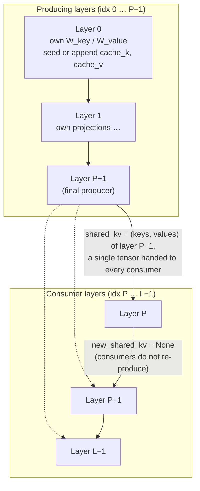
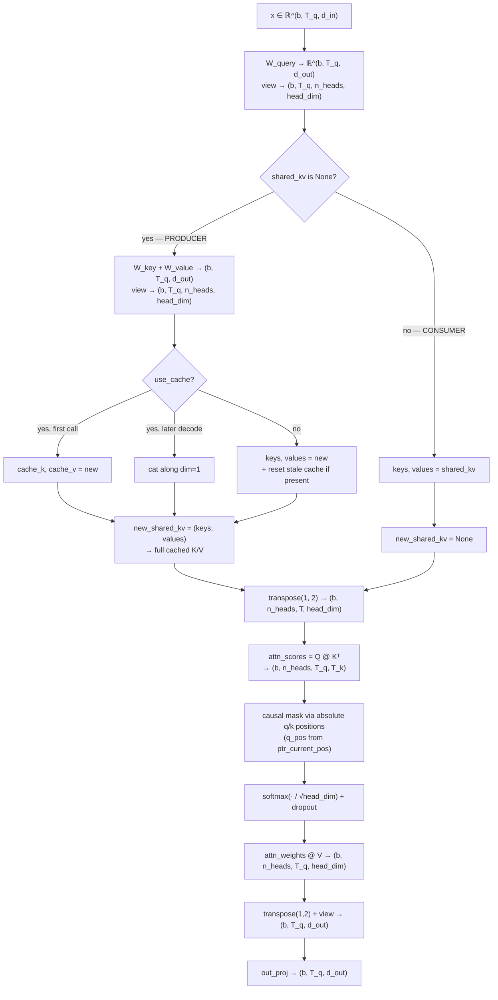

# Cross-Layer KV Sharing — First-Principles Design Notes

## What is cross-layer KV sharing?

Standard causal MHA gives **every** layer its own key and value projections, so a KV cache stores `n_layers` independent K/V tensors per token per layer. Cross-layer KV sharing (also called cross-layer attention, CLA) applies the *sharing* idea from GQA to a second axis: instead of sharing K/V *across query heads inside one layer*, it shares K/V **across layers**.

In this file, a small prefix of the stack — `n_kv_producing_layers` (call it `P`) — computes and caches its **own** K/V. Every layer from `P` to `n_layers − 1` skips its K/V projections entirely and reuses the K/V tensors produced by an earlier layer. Each layer still computes its **own queries**, so every layer keeps a distinct attention pattern; only the *key/value* pathway is shared.

| | MHA with KV cache | Cross-layer KV sharing (`P` producing layers) |
|---|---|---|
| K/V projections per layer | all `L` layers compute their own | `P` producer layers only; consumers reuse |
| KV cache tensors per layer | `n_heads · head_dim` per token, in **every** layer | `n_heads · head_dim` per token, in the **`P` producers only** |
| Cache memory footprint | ∝ `L` | ∝ `P` (e.g. 50% at `P = L/2`) |
| Queries | per-layer, per-head | per-layer, per-head (**unchanged**) |
| Attention scores | each layer: own `Q @ Kᵀ` | each layer: own `Q @ Kᵀ` (keys may be borrowed) |
| Parameters | `L · (3·d_in·d_out + d_out² )`-ish | **identical** (consumer K/V weights exist, they are just never *called*) |
| What is traded away | — | representational capacity: consumer layers cannot choose their own keys |

The mechanism is a **memory-side** optimization, not a parameter-side one. The parameter layout is byte-for-byte compatible with MHA — which is exactly what `test_kv_sharing_matches_mha_when_all_layers_produce_kv` relies on (`n_kv_producing_layers == n_layers` makes the model identical to MHA, so it must load a plain MHA checkpoint with `strict=True`).

> **Why it matters.** At long context the KV cache — not the weights — dominates device memory (see [Compute and memory analysis](#compute-and-memory-analysis)). Sharing turns the cache's `×n_layers` factor into `×n_kv_producing_layers`, a savings that **compounds multiplicatively** with GQA (`×kv_heads`) and can be composed with SWA's `×window` bound. Gemma 4 E2B/E4B combine all three.

---

## Architecture at a glance

The delta against ordinary MHA-with-cache is a *communication protocol*, not a new tensor:

1. Every attention layer understands a `shared_kv` argument: `None` means "you are a producer — compute and return your K/V"; a `(keys, values)` tuple means "you are a consumer — borrow these".
2. `GPTModel.forward` decides which role each layer plays, purely by comparing `layer_idx < n_kv_producing_layers`.
3. `TransformerBlock` becomes a pass-through relay for `shared_kv` (it adds no logic of its own).



Two first-principles observations that fall out of this diagram:

- **Single-source sharing.** `GPTModel.forward` reuses one loop variable; every producer *overwrites* it, so the K/V that reaches the consumer tail is the **final producer's** (layer `P−1`) — all `L − P` consumers borrow the *same* tensor. This is a deliberately simple topology. Gemma 4 instead maps each shared layer to a specific earlier layer of the same block type (see [Extensions and future research](#extensions-and-future-research)).
- **`TransformerBlock` is deliberately dumb.** It unpacks `(x, new_shared_kv)` and forwards both, so the attention module alone owns the protocol. This keeps the KV-sharing diff against the MHA baseline minimal.

---

## Structural invariants (`__init__` contract)

```python
assert d_out % num_heads == 0, "d_out must be divisible by num_heads"

if not 1 <= cfg["n_kv_producing_layers"] <= cfg["n_layers"]:
    raise ValueError("n_kv_producing_layers must be between 1 and n_layers.")
```

| Invariant | Effect |
|---|---|
| `d_out % num_heads == 0` | `head_dim = d_out // num_heads` is an integer; every head gets an equal slice of the projected output (identical to stock MHA). |
| `1 ≤ P ≤ n_layers` | At least one producer must exist (else there is nothing to share), and the partition must fit inside the stack. |
| Parameters are all present in **every** layer | Consumer layers keep `W_key`/`W_value`/`out_proj` in their module trees, so `state_dict` keys match an MHA model exactly — enabling the strict-load identity test. |

Two deliberate non-constraints (contrast with GQA/MLA):

- No divisibility rule like `num_heads % num_kv_groups == 0` — KV sharing does not touch the number of heads at all.
- `P` need not divide `L`, and does not need any particular relationship to `n_heads`. Any `1 ≤ P ≤ L` is a valid partition; the sharing is purely along the **layer axis**.

Reference config used throughout this document (the file's CLI defaults, shape-compatible with a 124M-class model):

| Symbol | Value | Meaning |
|---|---|---|
| `d_in` / `d_out` / `emb_dim` | 768 | input / projected width |
| `num_heads` | 12 | attention heads |
| `head_dim` | 64 | per-head dim (`√head_dim = 8` softmax scale) |
| `n_layers` (`L`) | 12 | transformer blocks |
| `n_kv_producing_layers` (`P`) | 6 | producers; `L − P = 6` consumers |
| `drop_rate` / `qkv_bias` | 0.0 / False | training flags (eval runs) |
| `context_length` | `max_new_tokens + len(prompt)` = 204 | default short-context run (`"Hello, I am"` → 4 GPT-2 tokens) |

---

## The `shared_kv` protocol

The entire mechanism is a two-branch contract on `forward(self, x, use_cache=False, shared_kv=None)`:

```python
if shared_kv is None:                      # ── PRODUCER path ──────────────
    keys_new   = self.W_key(x)             #   fresh K/V from own projection
    values_new = self.W_value(x)
    keys_new   = keys_new.view(b, T, n_heads, head_dim)
    values_new = values_new.view(b, T, n_heads, head_dim)

    if use_cache:                          #   seed or append own buffers
        if self.cache_k is None:
            self.cache_k, self.cache_v = keys_new, values_new
        else:
            self.cache_k = torch.cat([self.cache_k, keys_new], dim=1)
            self.cache_v = torch.cat([self.cache_v, values_new], dim=1)
        keys, values = self.cache_k, self.cache_v
    else:                                  #   training / non-cached: fresh, drop stale cache
        keys, values = keys_new, values_new
        if self.cache_k is not None or self.cache_v is not None:
            self.reset_cache()

    new_shared_kv = (keys, values)         #   hand K/V to the next layers
else:                                      # ── CONSUMER path ──────────────
    keys, values = shared_kv               #   borrow, skip W_key / W_value
    new_shared_kv = None                   #   nothing to propagate
```

| Contract clause | Correctness reason |
|---|---|
| Producer returns the **whole** `(keys, values)` — the full cache during decode, not the new chunk | Consumers must see the complete context; the borrowed tensor *is* the cache of layer `P−1`. |
| Consumer returns `new_shared_kv = None` | Prevents a consumer from accidentally being mistaken for a producer later in the loop. |
| `shared_kv` is passed **unnormalized and head-unfolded** (`b, T, n_heads, head_dim`) | Both branches converge on the same `transpose(1, 2)` before attention, so producer and consumer code paths meet on identical shapes. |
| Consumer still runs `W_query(x)` | Each layer's attention pattern stays its own — only K/V are borrowed. |

Note the shape subtlety: `shared_kv` carries the tensors in the *cache layout* `(b, num_tokens, n_heads, head_dim)`. The producer prepares keys/values in that layout and the consumer consumes them in that layout; the `.transpose(1, 2)` that converts to head-major happens *after* the branch, so both paths need identical code.

---

## GPTModel routing: who produces, who borrows

```python
shared_kv = None
for layer_idx, blk in enumerate(self.trf_blocks):
    if layer_idx < self.n_kv_producing_layers:
        x, shared_kv = blk(x, use_cache=use_cache, shared_kv=None)   # producer
    else:
        x, _ = blk(x, use_cache=use_cache, shared_kv=shared_kv)     # consumer
```

- Layers `0 … P−1` are called with `shared_kv=None` **explicitly**, so they never consume — each computes and caches its own K/V, and each *overwrites* the loop's `shared_kv` variable with its own result.
- Layers `P … L−1` are called with the accumulated `shared_kv`; they borrow it, compute only their own queries, and return `None` up.
- Because every producer overwrites the loop variable, the tail layers all share the **last** producer's K/V. This `O(1)` relay is the whole routing algorithm — there is no separate cache dictionary keyed by layer, unlike the Gemma 4 notebook (`cache.get(block.att.kv_shared_layer_index)`).
- The `use_cache` flag is forwarded unchanged into every layer; consumers simply never touch their (unused) cache buffers regardless of the flag.

---

## Step-by-step forward pass

Worked shapes: `b = 2`, `d_in = d_out = 768`, `num_heads = 12`, `head_dim = 64`. Routing example uses a small stack `L = 4, P = 2` so both roles fit in one picture.

### Prefill — producer layer (e.g. layer 0), input `x ∈ ℝ^(2, 4, 768)`

```python
queries   = W_query(x)        # (2, 4, 768)   = 12 heads × 64  ── always own
keys_new  = W_key(x)         # (2, 4, 768)
values_new= W_value(x)       # (2, 4, 768)
# view → (2, 4, 12, 64) for all three
```

**Cache seeding** (`use_cache=True`, `cache_k is None`):
```python
cache_k, cache_v = keys_new, values_new    # (2, 4, 12, 64)
keys, values = cache_k, cache_v            # full tensor handed down
new_shared_kv = (keys, values)             # relayed to layer ≥ P
q_start = 0, ptr_current_pos: 0 → 4
```

**Attention** (identical to stock MHA):
```python
keys_t/queries_t/values_t → transpose(1, 2)    # (2, 12, 4, 64)
attn_scores = q_t @ k_t.transpose(-1,-2)       # (2, 12, 4, 4)
# causal: q_pos = arange(0,4), k_pos = arange(0,4)
# mask q < k → −inf; scale /8; softmax; dropout; @ v_t → (2, 12, 4, 64)
# transpose back, view → (2, 4, 768) → out_proj
```

### Prefill — consumer layer (e.g. layer 2 when `L=4, P=2`), input `x ∈ ℝ^(2, 4, 768)`

```python
queries   = W_query(x)        # (2, 4, 768) — the ONLY projection this layer runs
# NO W_key, NO W_value, NO cache seed/append
keys, values = shared_kv      # the tensor produced by layer P−1 (= layer 1 here)
new_shared_kv = None
```

Attention then proceeds identically, over borrowed keys/values. The consumer's attention scores are `(2, 12, 4, 4)` with its own query row-mixing against the borrowed K/V.

### Decode — producer layer, input `x ∈ ℝ^(2, 1, 768)` (absolute position 4)

```python
keys_new, values_new = W_key(x), W_value(x)      # (2, 1, 12, 64)
cache_k = cat([cache_k, keys_new], dim=1)        # → (2, 5, 12, 64)
cache_v = cat([cache_v, values_new], dim=1)
keys, values = cache_k, cache_v                  # returned IN FULL to consumers
new_shared_kv = (keys, values)                   # (2, 5, 12, 64) — entire history
q_start = 4, ptr_current_pos: 4 → 5
```

### Decode — consumer layer, input `x ∈ ℝ^(2, 1, 768)`

```python
queries = W_query(x)                     # (2, 1, 768) → (2, 12, 1, 64)
keys, values = shared_kv                 # the *grown* (2, 5, 12, 64) cache of producer P−1
# attention: attn_scores (2, 12, 1, 5); q_pos = [4], k_pos = [0..4]
# → no future cells → mask row all-zero; softmax over all 5 borrowed keys
```

The consumer immediately sees the **just-appended token**: because the producer passes the whole cache (not just the new chunk), the consumer's `attn_scores` width grows from 4 to 5 in lockstep with the producer cache. Consumers never hold their own cache but do advance `ptr_current_pos` every step — the pointer must stay in lockstep so that their absolute query positions keep matching the borrowed keys (see [KV cache design](#kv-cache-design--the-two-tier-cache-and-why-consumers-need-no-buffer)).

---

## Full forward-pass flowchart



---

## KV cache design — the two-tier cache (and why consumers need no buffer)

### Who stores, who borrows

| Layer range | Role | `cache_k` / `cache_v` after a cached run | K/V used in attention |
|---|---|---|---|
| `0 … P−1` | producer | populated, grow by `T_chunk` each call | own projections (also handed out as `shared_kv`) |
| `P … L−1` | consumer | stay `None` **forever** | borrowed from producer `P−1` |

This is the invariant `test_only_producer_layers_store_kv_cache` asserts directly: after a cached forward, `blk.att.cache_k.size(1) == T` for the producers and `cache_k is None` for every consumer. The cache memory of the whole model is therefore bounded by `P` buffers, regardless of `L`.

### Why consumers need no buffer (and must still advance the pointer)

- Consumers receive the *already-grown* producer cache every step, so storing anything themselves would be redundant.
- Yet they **do** run the pointer arithmetic: `q_positions = arange(ptr_current_pos, ptr_current_pos + num_tokens_Q)`; `ptr_current_pos += num_tokens_Q`. All layers advance their pointer in lockstep (each sees exactly the same `num_tokens_Q` sequence of calls), so a consumer's `q_positions` stays aligned with the absolute positions of the borrowed keys. If a consumer did *not* advance its pointer, its causal mask would silently drift out of sync after the first decode step.
- `k_positions = arange(num_tokens_K)` always starts at `0` because the producer caches are **unbounded and never trimmed** (unlike SWA). The borrowed cache always begins at absolute position 0, so a simple `arange` over its length is correct for every consumer too.

### Growth semantics — unbounded, never trimmed

```python
if cache_k is None:
    cache_k, cache_v = keys_new, values_new                  # seed
else:
    cache_k = torch.cat([cache_k, keys_new], dim=1)          # append along token axis
    cache_v = torch.cat([cache_v, values_new], dim=1)
```

| Call | Input `x` | Producer cache after | Consumer `cache_k` | `q_start` | `k_start` |
|---|---|---|---|---|---|
| prefill `[0..3]` | (2, 4, 768) | 4 tokens | `None` | 0 | 0 |
| decode token 4 | (2, 1, 768) | 5 tokens | `None` | 4 | 0 |
| decode token 5 | (2, 1, 768) | 6 tokens | `None` | 5 | 0 |

```mermaid
block-beta
    columns 10
    block:Prod["Producing layer P−1 — the only owner"]
        P1["k0/v0"] P2["k1/v1"] P3["k2/v2"] P4["k3/v3"] P5["k4/v4"]
    end
    space
    block:Cons["Consumer layer P (and every layer after it)"]
        C1["borrow (k0..k4 / v0..v4) — one shared tensor, grown by the producer"] 
    end
end
```

### Mask correctness in every mode

| Mode | `num_tokens_Q` | `num_tokens_K` (consumer) | Mask |
|---|---|---|---|
| Training / full forward (`use_cache=False`) | full `T` | `T` (fresh, from producer layer P−1) | square causal triangle |
| Prefill (one shot) | full prompt `T` | `T` (producer seed) | square causal triangle |
| Decode | 1 | `S` (producer cache) | `1 × S` row; allowed iff `q_pos < k_pos` never fires |

---

## Compute and memory analysis

### Parameters: deliberately unchanged

```python
# every block, producer or consumer, instantiates:
W_query, W_key, W_value, out_proj     # consumer W_key/W_value are simply never .forward()ed
```

So ragged/drop-the-weights savings are *not* realized by this file — the win is in the KV cache and in skipped K/V projection FLOPs, not in parameter count. (A production variant would drop consumer K/V matrices; Gemma 4 keeps per-type KV projections and shares between matched layers instead.)

### KV-cache memory

With `bytes_per_elem` (2 for bf16/fp16):

```
MHA cache      = b · C · head_dim                 · n_heads               · n_layers               · 2 · bytes
GQA cache      = b · C · head_dim                 · (n_heads ÷ kv_groups) · n_layers               · 2 · bytes
MHA + sharing  = b · C · head_dim                 · n_heads               · n_kv_producing_layers  · 2 · bytes
GQA + sharing  = b · C · head_dim                 · (n_heads ÷ kv_groups) · n_kv_producing_layers  · 2 · bytes
```

Sharing swaps `n_layers → n_kv_producing_layers` (multiplier `P / L`); GQA additionally swaps `n_heads → n_heads ÷ kv_groups`. The two factors multiply. The shipped `memory_estimator_kv_sharing.py` computes all four combinations.

Worked numbers (bf16, batch 1) — 124M-class reference config (`head_dim=64`, `L=12`, `P=6`, `n_heads=12`):

| Context `C` | MHA cache | MHA + sharing (P=6) | Saving |
|---|---|---|---|
| 204 (default run) | 7.52 MB | 3.76 MB | 50% |
| 2,048 | 75.50 MB | 37.75 MB | 50% |
| 32,768 | 1.21 GB | 0.60 GB | 50% |

Gemma 4-like presets from the README (context 131,072, bf16, batch 1):

| Config | MHA | GQA | MHA + sharing | **GQA + sharing** |
|---|---|---|---|---|
| E2B-like (35 layers, P=15, 8 heads → 1 KV head) | 37.58 GB | 4.70 GB | 16.11 GB | **2.01 GB** (18.67× vs MHA) |
| E4B-like (42 layers, P=24, 8 heads → 2 KV heads) | 56.37 GB | 14.09 GB | 32.21 GB | **8.05 GB** (7.00× vs MHA) |

### Compute: where the real (small) FLOP savings sit

- **Producers** run `W_key`/`W_value` — one extra `d_in → d_out` pair per token.
- **Consumers** skip both projections entirely: prefill saves `2·d_in·d_out·T` multiply-adds per consumer layer; decode saves `2·d_in·d_out` per token per consumer layer.
- The dominant cost — `Q @ Kᵀ` and `@ V` against a growing `S`-token context — is **not** reduced at all: `O(S·d)` per decoded token per layer regardless of sharing.

Honest takeaway: this file's sharing is a cache-memory optimization with secondary FLOP perks. Its real power shows only when composed with long context and/or stacked with GQA/SWA — the Gemma 4 pattern. At the default short run (~7.5 MB cache vs. ~0.3 GB of weights) the absolute numbers are tiny; the mechanism exists to make *long* generation feasible.

---

## KV sharing vs the sibling cache optimizations

Each design shrinks a *different axis* of the cache tensor `(b, C, n_kv_heads, head_dim, L)`:

| Axis | MHA | GQA | MLA | SWA | **KV sharing** |
|---|---|---|---|---|---|
| `n_kv_heads` | `n_heads` | `n_heads ÷ kv_groups` | 1 latent | `n_heads` | `n_heads` |
| `head_dim` | `head_dim` | `head_dim` | compressed latent `d_c` | `head_dim` | `head_dim` |
| `C` (sequence) | unbounded | unbounded | unbounded | `≤ W` | unbounded |
| `L` (layers) | `L` | `L` | `L` | `L` | **`P`** |

The optimizations are **orthogonal and multiplicative**: GQA collapses heads, KV sharing collapses layers, SWA collapses the window, MLA collapses per-token width. The Gemma 4 design combines sharing + GQA/MQA + SWA. This file intentionally implements *only* the layer axis so the mechanism stays legible — exactly as the sibling `GQA_DESIGN_NOTES.md` isolates its head-axis sharing.

---

## Integration (TransformerBlock / GPTModel)

```python
self.att = MultiHeadAttentionWithKVSharing(
    d_in=cfg["emb_dim"],        d_out=cfg["emb_dim"],
    num_heads=cfg["n_heads"],   dropout=cfg["drop_rate"],
    qkv_bias=cfg["qkv_bias"],
)
```

- The single KV-sharing-specific config key is `n_kv_producing_layers`, read once in `GPTModel.__init__` and used to set `self.n_kv_producing_layers`. `TransformerBlock` receives *no* extra config — it only relays `shared_kv` in `forward(x, use_cache, shared_kv)`.
- `GPTModel.forward` replaces the plain `for blk in self.trf_blocks` loop with the producer/consumer routing loop (see [GPTModel routing](#gptmodel-routing-who-produces-who-borrows)).
- `generate_text_simple_cached(..., use_cache=True)` calls `model.reset_kv_cache()` → every block's `att.reset_cache()` plus `self.current_pos = 0`, then alternates a full-prompt prefill pass and single-token cached forwards — identical orchestration to the MHA sibling.
- Because the parameter layout matches MHA exactly, a KV-sharing model with `P = L` is a strict drop-in for a stock checkpoint (`test_kv_sharing_matches_mha_when_all_layers_produce_kv`), and with `P < L` the consumer `W_key`/`W_value` weights simply go unused.

---

## Cache reset semantics

```python
def reset_cache(self):
    self.cache_k, self.cache_v = None, None
    self.ptr_current_pos = 0
```

- Reset is invoked once per generation run: `model.reset_kv_cache()` loops all blocks so **producer** buffers are cleared and **all** pointers (producers *and* consumers) are re-zeroed in lockstep.
- The consumer buffers were already `None`; resetting them is a harmless no-op that keeps the API uniform.
- Buffers are registered `persistent=False`, so they move with `.to(device)` / `.to(dtype)` but never enter `state_dict` checkpoints.
- With `use_cache=False` (training), each attention forward re-zeroes its own pointer and drops any stale cache (`if cache_k is not None or cache_v is not None: self.reset_cache()`), so cached and training paths cannot leak state into each other.

---

## Extensions and future research

Signposts for going beyond this minimal version, in rough order of proximity:

- **Paired sharing (Gemma 4 / CLA follow-ups).** Map consumer layer `i` to a *specific* producer layer of the same block type instead of "everybody borrows the last producer." The in-repo Gemma 4 notebook (`LLMs-from-scratch/ch05/17_gemma4/standalone-gemma4-plus-kvcache.ipynb`) shows the more realistic approach: `kv_shared_layer_index` per shared layer, K/V pulled from a cache keyed by that index, plus composition with GQA/MQA and SWA.
- **Dropping unused weights.** A production variant deletes consumer `W_key`/`W_value` (SVD- or distillation-based weight sharing then gives parameter savings on top of cache savings). The check-compatibility property of this file (state-dict identity) is the training-time harness that makes such surgery safe to verify.
- **Composition.** Measure `share × GQA × SWA` jointly (the memory formulas already multiply); this file's estimator supports the first two factors today.
- **Fine-tuning / capacity recovery.** Claim "reduced capacity" explicitly: consumer layers forfeit their own keys. Publications on whether fine-tuning recovers the lost expressivity are an active direction.

## References

**Primary / mechanism**

- Brandon et al., *Reducing Transformer Key-Value Cache Size with Cross-Layer Attention*, 2024. [arXiv:2405.12981](https://arxiv.org/abs/2405.12981) — the cross-layer attention scheme this file implements in miniature.
- Google, *Gemma 4: Expanded & Enhanced* (E2B/E4B), 2025 — production compounding of KV sharing with GQA/MQA and sliding window; in-repo mirror: `LLMs-from-scratch/ch05/17_gemma4/`.
- Sun et al., *You Only Cache Once: Decoder-Decoder Architectures for Language Models*, 2024. [arXiv:2405.05254](https://arxiv.org/abs/2405.05254) — a cross-layer KV reuse design (YOCO) that caches K/V once and reuses it in later decoder blocks.

**Sibling optimizations in this repo (orthogonal axes)**

- Ainslie et al., *GQA: Training Generalized Multi-Query Transformer Models from Multi-Head Checkpoints*, 2023. [arXiv:2305.13245](https://arxiv.org/abs/2305.13245) — head-axis sharing: [`../gqa/GQA_DESIGN_NOTES.md`](../gqa/GQA_DESIGN_NOTES.md).
- DeepSeek-AI, *DeepSeek-V2: A Strong, Economical, and Efficient Mixture-of-Experts Language Model*, 2024. [arXiv:2405.04434](https://arxiv.org/abs/2405.04434) — latent compression (MLA): [`../mla/MLA_DESIGN_NOTES.md`](../mla/MLA_DESIGN_NOTES.md).
- Jiang et al., *Mistral 7B*, 2023. [arXiv:2310.06825](https://arxiv.org/abs/2310.06825) — window-axis bounding (SWA): [`../swa/SWA_DESIGN_NOTES.md`](../swa/SWA_DESIGN_NOTES.md).
- Raschka, *Build a Large Language Model From Scratch*, ch. 4 — `03_kv-cache` (the cache this file builds on), `10_kv-sharing` (upstream source of this directory).

**KV-cache-reduction literature that informs future research**

- Zhang et al., *CacheGen: Fast Context Loading for Language Model Applications via KV Cache Streaming*, 2024. [arXiv:2410.17744](https://arxiv.org/abs/2410.17744) — lossy KV-cache compression for low-latency context shipping.
- Liu et al., *SnapKV: LLM Knows What You Are Looking For Before Generation*, 2024. [arXiv:2404.14469](https://arxiv.org/abs/2404.14469) — keep only attention-relevant KV segments (complementary to, not exclusive with, cross-layer sharing).
- Zhang et al., *H2O: Heavy-Hitter Oracle for Efficient Generative Inference of Large Language Models*, 2023. [arXiv:2306.14048](https://arxiv.org/abs/2306.14048) — token-eviction KV compression.
- Liu et al., *KIVI: A Tuning-Free Asymmetric 2bit Quantization for KV Cache*, 2024. [arXiv:2402.02750](https://arxiv.org/abs/2402.02750) — numerically quantizing the same tensors sharing keeps.
- Hooper et al., *KVQuant: Towards 10 Million Context Length LLM Inference with KV Cache Quantization*, 2024. [arXiv:2401.18079](https://arxiv.org/abs/2401.18079) — per-channel/per-token KV quantization.
- Ge et al., *Model Tells You What to Discard: Adaptive KV Cache Compression of Long-Context LLMs*, 2024. [arXiv:2410.05239](https://arxiv.org/abs/2410.05239) — budgeted per-layer KV allocation (per-layer *sizing* as a cousin of per-layer sharing).

**Related but distinct (do not conflate)**

- Elhoushi et al., *LayerSkip: Enabling Early Exit Inference and Self-Speculative Decoding*, 2024. [arXiv:2407.16728](https://arxiv.org/abs/2407.16728) — *skipping whole layers* at inference (compute), not sharing K/V tensors (memory); the two compose.
- Lan et al., *ALBERT: A Lite BERT for Self-supervised Learning of Language Representations*, 2019. [arXiv:1909.11942](https://arxiv.org/abs/1909.11942) — *weight* sharing across transformer layers; different from sharing *activations* (KV), useful to contrast when studying parameter-vs-cache trade-offs.

**Source files**

- This directory: [`gpt_with_kv_sharing.py`](gpt_with_kv_sharing.py) (KV sharing + cache), [`README.md`](README.md) (usage and Gemma 4 numbers).
- Upstream sibling: `LLMs-from-scratch/ch04/10_kv-sharing/gpt_with_kv_mha.py` (MHA-with-cache baseline for a fair diff), `memory_estimator_kv_sharing.py` and `plot_memory_estimates_kv_sharing.py` (memory math and curves), `tests.py` (the three contract tests referenced above).
