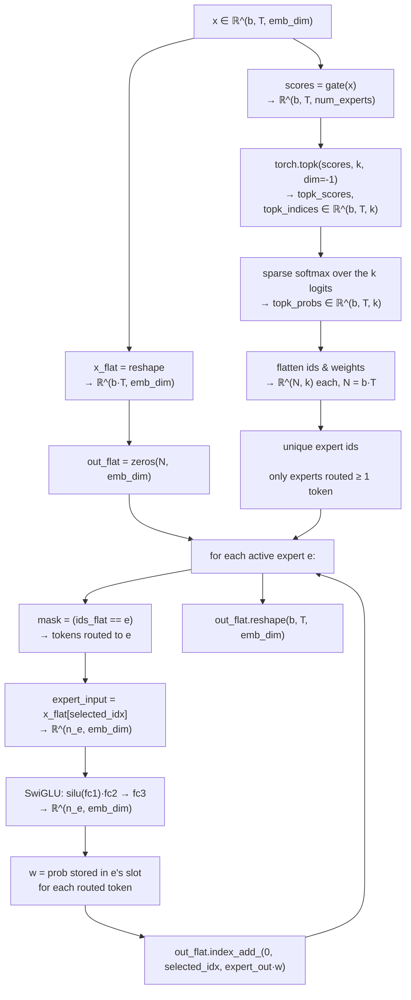
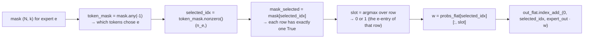

# Mixture-of-Experts Feed-Forward — First-Principles Design Notes

## What is MoE?

The feed-forward block inside a transformer holds a large share of the model's parameters (in a 12-layer GPT these layers dominate the parameter count). Mixture-of-Experts (MoE, [Shazeer et al. 2017](https://arxiv.org/abs/1701.06538)) replaces the *single* FFN with a lightweight **router (gate)** plus **E expert FFNs**. Each token is scored against every expert by the gate, routed to its **top-k** highest-scoring experts, and the layer output is the gate-weighted sum of those k expert outputs.

All E experts' weights are *loaded* into memory, so the layer's parameter count grows roughly `E×`. But only **k experts are computed per token** — the layer is *sparse* (activates a subset) instead of *dense* (activates everything). This is the core MoE trade-off: more capacity, similar per-token FLOPs.

| | Dense FFN (`FeedForward`) | Sparse MoE (`MoEFeedForward`) |
|---|---|---|
| FFN blocks per layer | 1 | E experts + 1 gate |
| Active per token | all parameters | top-k experts only |
| Layer parameters | `emb_dim × hidden_dim` ×(2 or 3) | gate `emb_dim × E` + E × (fc1,fc2,fc3) |
| Activation memory | `hidden_dim` per token | ~`k · hidden_dim` per token (routed) |
| Representational capacity | fixed | grows with E (specialized experts) |
| Compute per token | one dense path | k expert paths + routing overhead |

The numbered reference config used throughout: `b=2, T=4, emb_dim=768, hidden_dim=3072, num_experts=8, num_experts_per_tok=2` (used for all worked shapes below).

---

## Routing contract (`__init__`)

```python
self.gate = nn.Linear(cfg["emb_dim"], cfg["num_experts"], bias=False)   # scores every expert
self.fc1  = nn.ModuleList([nn.Linear(emb_dim, hidden_dim, bias=False) for _ in range(num_experts)])
self.fc2  = nn.ModuleList([nn.Linear(emb_dim, hidden_dim, bias=False) for _ in range(num_experts)])
self.fc3  = nn.ModuleList([nn.Linear(hidden_dim, emb_dim, bias=False) for _ in range(num_experts)])
```

| Config key | Role |
|---|---|
| `num_experts` (E) | how many expert FFNs exist |
| `num_experts_per_tok` (k) | how many are active per token |
| `hidden_dim` | the **per-expert** interior size (total interior capacity is `E · hidden_dim`) |
| `emb_dim` | input/output width, shared with attention |

- No divisibility invariants (unlike GQA/SWA): E and k are independent shape choices. The only implicit contract is `k ≤ E` (outside each row's k entries `topk` has nothing to select).
- Degenerate cases are well-defined: `k=1` is hard top-1 routing; `k=E` evaluates every expert (a dense mixture — but still E separate FFNs plus a gate).
- All projections are **bias-free** — the gate is a pure score function and the experts use the book's SwiGLU convention.
- Parameter math: `E·3·emb_dim·hidden_dim` (experts) + `emb_dim·E` (gate) **total**, but only `k·3·emb_dim·hidden_dim + emb_dim·E` **active per token**.

---

## The expert network: SwiGLU (not GELU)

The dense GPT-2 FFN is a two-matrix stack `W1 → GELU → W2`. Each MoE expert instead uses **SwiGLU** ([Shazeer et al. 2020](https://arxiv.org/abs/2002.05202)): three matrices where an elementwise SiLU gate rescales the parallel branch:

```python
hidden     = silu(fc1_e(x)) * fc2_e(x)   # SiLU(x) = x·sigmoid(x); elementwise product
expert_out = fc3_e(hidden)
```

Same tensor FLOPs as two stacked linears, but the gate `silu(fc1(x))` multiplicatively shapes `fc2(x)` per element — the same expert shape Mixtral uses. Note `hidden_dim` is used **verbatim** as each expert's interior width (no Llama-style ⅔ downscaling), which is why a fair param-matched comparison shrinks the expert size (see "Sparse vs dense" below).

---

## Sparse gating: logits → top-k → softmax

Concrete example for one token with `E=8, k=2`, gate row:

```
gate(x) = [-2.1, 0.8, 1.6, -0.4, 0.9, -1.3, 2.4, 0.1]     # logits, one per expert

top-2   →  expert 6 (2.4), expert 2 (1.6);  the other 6 logits are dropped
softmax over the kept two →  w = [0.690, 0.310]            # e^2.4=11.02 / e^1.6=4.95

y_token = 0.690 · Expert_6(x_token) + 0.310 · Expert_2(x_token)
```

Key semantics:

- The softmax runs over the **k chosen logits only** (Mixtral-style *sparse* softmax), *not* over all E experts. Per token `Σw = 1`, so `y_token` is a **convex combination** of the k routed expert outputs.
- `torch.topk` sorts each row's indices by descending score, so slot 0 is always the highest-scoring expert — this ordering is load-bearing for the weight lookup later.
- Routing is **data-dependent**: the same token id can land on different experts in a different context, and the chosen set varies per token.
- This file adds no temperature and no load-balancing loss (see "Extensions" below); it is a deliberately bare implementation.

---

## Step-by-step forward pass

Reference config for the worked shapes: `b=2, T=4, emb_dim=768, hidden_dim=3072, num_experts=8, num_experts_per_tok=2` → `N = b·T = 8` token rows.

### Step 1 — Gate logits
```python
scores = self.gate(x)                          # (2, 4, 8) — logit per expert per token
```

### Step 2 — Top-k expert selection
```python
topk_scores, topk_indices = torch.topk(scores, self.num_experts_per_tok, dim=-1)
# both (2, 4, 2): chosen expert ids + their logits, ordered by descending score
```

### Step 3 — Sparse softmax → gating weights
```python
topk_probs = torch.softmax(topk_scores, dim=-1)   # (2, 4, 2); rows sum to 1
```

### Step 4 — Flatten to per-token rows
```python
batch, seq_len, _ = x.shape
x_flat   = x.reshape(batch * seq_len, -1)                       # (8, 768)
out_flat = torch.zeros(batch * seq_len, self.emb_dim, device=x.device, dtype=x.dtype)  # (8, 768)
```
`out_flat` is the zero-initialized **accumulation buffer**: each expert scatter-adds its weighted output into the rows it owns.

### Step 5 — Flatten the routing tables
```python
topk_indices_flat = topk_indices.reshape(-1, self.num_experts_per_tok)   # (8, 2) expert ids
topk_probs_flat   = topk_probs.reshape(-1, self.num_experts_per_tok)     # (8, 2) weights, same row order
```

### Step 6 — Enumerate the active experts
```python
unique_experts = torch.unique(topk_indices_flat)   # e.g. {1, 3, 7}: experts chosen by ≥ 1 token
```
Only experts that actually received tokens are touched — the layer never computes an unused expert.

### Step 7 — Per-expert gather → compute → scatter
```python
for expert_id in unique_experts:
    mask = topk_indices_flat == expert_id               # (8, 2): which slots chose this expert
    selected_idx = mask.any(dim=-1).nonzero(as_tuple=False).squeeze(-1)   # token rows routed here

    expert_input = x_flat.index_select(0, selected_idx)                  # (n_e, 768)
    hidden       = silu(self.fc1[expert_id](expert_input)) * self.fc2[expert_id](expert_input)
    expert_out   = self.fc3[expert_id](hidden)                           # (n_e, 768)

    # per-token weight = the probability stored in this expert's slot for that token
    slot         = mask[selected_idx].int().argmax(dim=-1, keepdim=True)
    w            = topk_probs_flat.index_select(0, selected_idx).gather(-1, slot).squeeze(-1)

    out_flat.index_add_(0, selected_idx, expert_out * w.unsqueeze(-1))   # scatter-add
```

### Step 8 — Unflatten
```python
return out_flat.reshape(batch, seq_len, self.emb_dim)   # (2, 4, 768)
```

---

## Forward-pass flowchart



## Per-expert scatter macro



---

## The gather–compute–scatter loop, from first principles

### The routing table

The flattened view turns routing into a single `(N, k)` table whose rows are per token:

```
topk_indices_flat (N=4, k=2)          topk_probs_flat (N=4, k=2)
┌────────────┬────────────┐          ┌────────────┬────────────┐
│ 3          │ 7          │          │ 0.62       │ 0.38       │  ← token 0
│ 1          │ 3          │          │ 0.55       │ 0.45       │  ← token 1
│ 3          │ 5          │          │ 0.71       │ 0.29       │  ← token 2
│ 1          │ 5          │          │ 0.60       │ 0.40       │  ← token 3
└────────────┴────────────┘          └────────────┴────────────┘

expert 3 → mask rows (T,F) (F,T) (T,F) (F,F)
         → routed tokens {0, 1, 2}, slots {0, 1, 0}
         → weights {0.62, 0.45, 0.71}   (one contribution per token)
```

### Why the slot lookup works

`topk` never repeats an expert within a row, so for a fixed expert each row of `mask_selected` contains **at most one True**. `argmax` therefore recovers that expert's position (slot 0 = rank-1 score, slot 1 = rank-2, …) and `torch.gather` pulls the matching probability out of `topk_probs_flat`. This is what maps "probability that this token assigned to this expert" correctly when experts occupy different slots across tokens.

### Why `index_add_` and not assignment

A flat token index appears in **k different rows** of the loop — once per expert in its top-k. Assignment (`out_flat[idx] = ...`) would overwrite the previous expert's contribution; `index_add_` *accumulates*, which is exactly the weighted-mixture semantics:

```
token 0:  out[0] = 0.62·Expert_3(x) + 0.38·Expert_7(x)
token 1:  out[1] = 0.55·Expert_1(x) + 0.45·Expert_3(x)
```

Within a single expert iteration `selected_idx` has no duplicates, so the scatter-add is a clean row-wise accumulate; across iterations the same row is revisited by its other experts. Tokens that did not route to an expert stay untouched in its iteration, and the zero-init buffer guarantees they are not polluted.

---

## Sparse vs dense: parameters and activation memory

For `emb_dim=768, hidden_dim=3072` (this file's default), `E=8`, `k=2`:

| | Dense FFN (GELU, `num_experts=0`) | MoE top-2 |
|---|---|---|
| Matrices per layer | 2 (`W1→GELU→W2`) | gate + 8 × (fc1,fc2,fc3) |
| Total parameters | 768·3072·2 ≈ **4.72M** (+biases) | 768·8 + 8·768·3072·3 ≈ **56.6M** |
| Active per token | 4.72M (100%) | 768·8 + 2·768·3072·3 ≈ **14.2M** (≈ 25%) |
| Active share | 1× | `k/E = 2/8 = 25%` of the MoE's own total |

The active fraction is exactly `k/E` (the gate is negligible): capacity grows ~E×, per-token compute stays at k experts. For a *param-matched* comparison, `memory_estimator_moe.py` (in the book's source `LLMs-from-scratch/ch04/07_moe/`) solves for the per-expert size that matches the dense total:

```
E · 3 · emb_dim · moe_hidden + emb_dim · E  ≈  3 · emb_dim · hidden_dim     # swiglu case
```

Example from the chapter README (`emb_dim=7168, dense hidden=14336, E=8, k=2`, `--match_dense`): dense FFN ≈ 308M params, MoE active ≈ 77M params per token (0.62 GB vs 0.15 GB resident-activation savings), while the full model peak stays dominated by loaded weights + KV cache.

---

## TransformerBlock integration

```python
self.ff = MoEFeedForward(cfg) if cfg["num_experts"] > 0 else FeedForward(cfg)
```

- `MoE` is a **drop-in replacement for the FFN sub-block only**. Attention (including the KV cache), both `LayerNorm`s, and the residual shortcuts are untouched — the layer is activated purely by the config flag `num_experts > 0` (with `num_experts_per_tok` forced to 0 on the dense path).
- **Timing/memory instrumentation** wraps the FF call: `torch.cuda.reset_peak_memory_stats()` before, `max_memory_allocated()` after, plus a `perf_counter` delta. The per-call `(time, peak-mem delta)` tuples accumulate in `MOE_FF_TIME_MS` / `MOE_FF_MEM_BYTES` and print as avg/max at the end of generation. These are **per block, per forward call** numbers — across 12 blocks every decode step amortizes into the averages, mixing prefill (multi-token) and decode (1-token) calls.
- The FF runs on whatever token count the block sees: KV-cache semantics do not interact with routing — the cache stores K/V for attention only, while experts are recomputed per call (they store nothing across steps).

| Mode | FF input per call | Routing | KV cache |
|---|---|---|---|
| Prefill | full prompt (one call) | top-k per token | seeded |
| Decode | 1 token | top-k (single row) | appended per step |
| Training / `--no_kv_cache` | full context per call | top-k per token | unused, recomputed |

---

## MoE vs the sibling dense-FFN baseline

| Concern | `FeedForward` (dense) | `MoEFeedForward` |
|---|---|---|
| Activation | GELU | SiLU (SwiGLU) |
| Interior width | `hidden_dim` | `k` routed experts × `hidden_dim` each |
| Weighted combination | — | softmax-weighted sum over top-k |
| Compute | fixed per token | data-dependent (routing + k experts) |
| Params vs active | 100% / 100% | ~8× / ~25% (k=2, E=8) |
| State across calls | none | none (both stateless; only attention caches) |

Note the book's sibling `gpt_with_kv_ffn.py` (in `LLMs-from-scratch/ch04/07_moe/`) uses a **SwiGLU dense FFN** rather than the GELU `FeedForward` fallback in this file, precisely so the dense baseline is SHAPE-comparable to one expert. The `--num_experts 0` fallback here keeps the classical GPT-2 FFN for identity with the main book code.

---

## Cache reset semantics

MoE owns **no persistent state**, so `reset_kv_cache` semantics are identical to the MHA baseline:

```python
def reset_cache(self):                       # MultiHeadAttention
    self.cache_k, self.cache_v = None, None
    self.ptr_current_pos = 0
```

`generate_text_simple_cached` → `model.reset_kv_cache()` → `blk.att.reset_cache()` per block, run once at the start of a generation. The MoE layer simply re-routes on every call with its current input.

---

## Extensions seen in production MoE (why this file is minimal)

- **Load balancing** — a bare top-k gate can collapse (one expert takes most traffic). Switch/Mixtral add an auxiliary load-balancing loss on the gate distribution; DeepSeek also adds a **shared expert** always active for every token.
- **Router quality** — production gates may add temperature, learned biases, or per-expert normalization, all absent here.
- **Scale** — DeepSeek-V3 uses 256 experts with 9 active; this file's pattern (gate → top-k → sparse softmax → weighted sum) is the same mechanism at toy scale.

The value of this implementation is legibility: one gate, k-of-E routing, SwiGLU experts, and a weighted-sum merge, with the KV cache inherited unchanged.

---

## Verbatim-copy quirks (in `gpt_with_kv_moe.py`)

Two typos carried over from the source copy — the documented flow above assumes them corrected:

- `scores = self.gate(x),` — trailing comma makes a **1-tuple**; `torch.topk` then raises `TypeError`. Intended: `scores = self.gate(x)`.
- `torch.empty(..., dtype=idx.stype, ...)` in `generate_text_simple_cached` — `stype` is a typo for `dtype`; raises `AttributeError` before generation.

---

## References

- Shazeer et al., *Outrageously Large Neural Networks: The Sparsely-Gated Mixture-of-Experts Layer*, 2017. [arXiv:1701.06538](https://arxiv.org/abs/1701.06538) — the original sparsely-gated MoE layer.
- Shazeer et al., *GLU Variants Improve Transformer*, 2020. [arXiv:2002.05202](https://arxiv.org/abs/2002.05202) — SwiGLU expert shape.
- Fedus et al., *Switch Transformers: Scaling to Trillion Parameter Models with Simple and Efficient Sparsity*, 2021. [arXiv:2101.03961](https://arxiv.org/abs/2101.03961) — top-k simplified routing + load-balancing loss.
- Jiang et al., *Mixtral of Experts*, 2024. [arXiv:2401.04088](https://arxiv.org/abs/2401.04088) — sparse softmax over routed-only logits, 8-expert MoE.
- Dai et al., *DeepSeekMoE: Towards Ultimate Expert Specialization*, 2024. [arXiv:2401.06066](https://arxiv.org/abs/2401.06066) — shared experts + auxiliary-loss-free balancing.
- Source implementation: [`gpt_with_kv_moe.py`](gpt_with_kv_moe.py) in this directory. Sibling book-source files (dense SwiGLU baseline, parameter estimator, plots) live in `LLMs-from-scratch/ch04/07_moe/`; a trained MoE + KV-cache notebook is at `ch05/11_qwen3/standalone-qwen3-moe-plus-kvcache.ipynb`.
- Related design notes: [`SWA_DESIGN_NOTES.md`](../swa/SWA_DESIGN_NOTES.md) and [`GQA_DESIGN_NOTES.md`](../gqa/GQA_DESIGN_NOTES.md) (same style for the other two architecture optimizations).